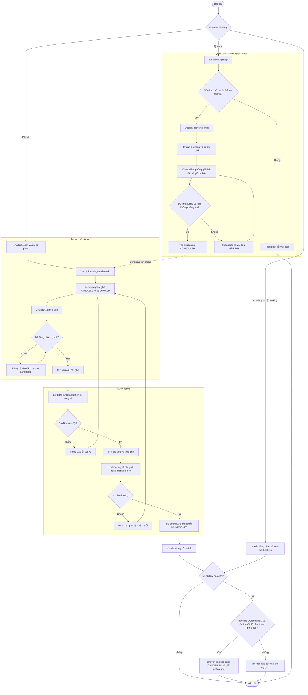
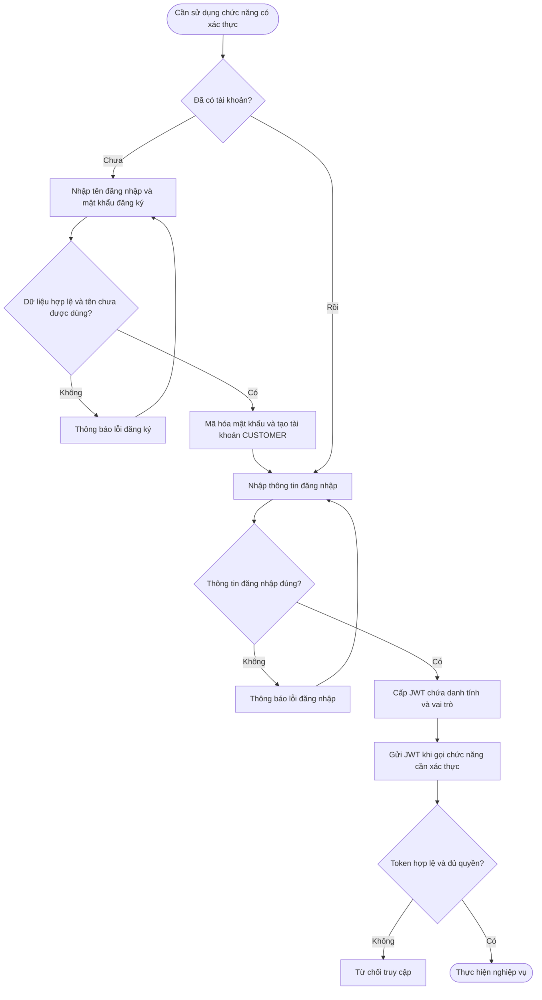
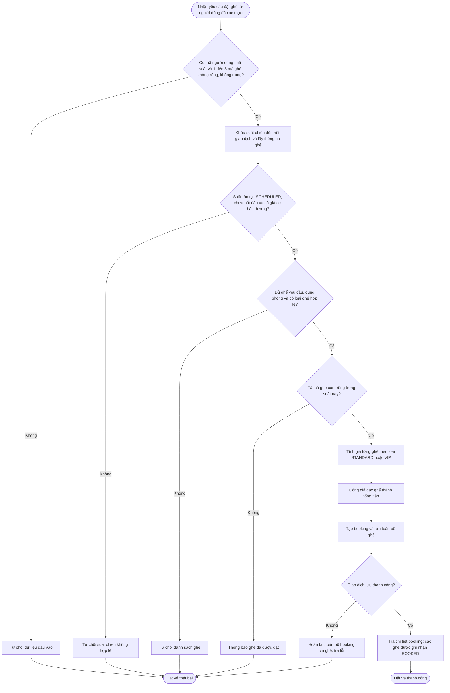
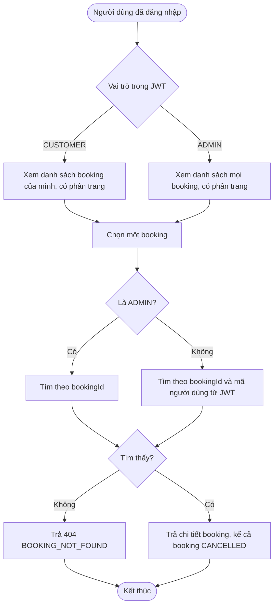
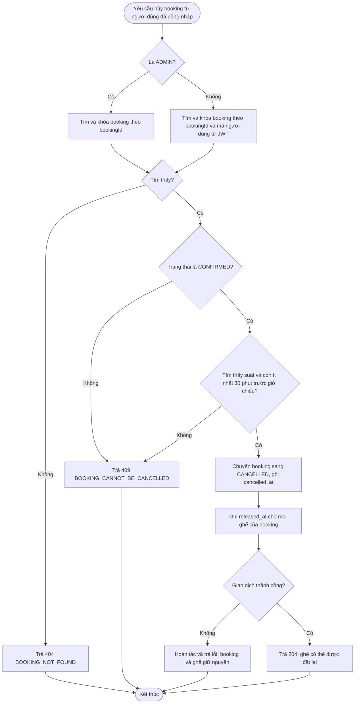
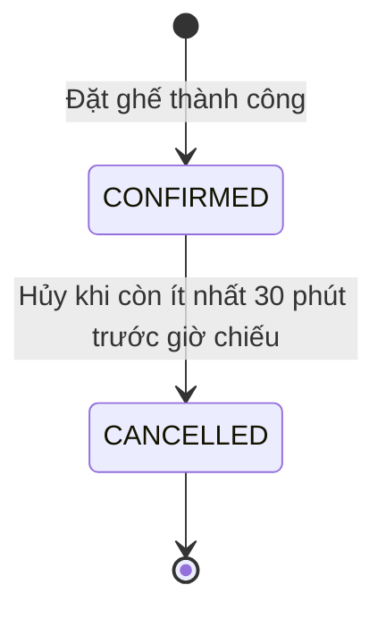
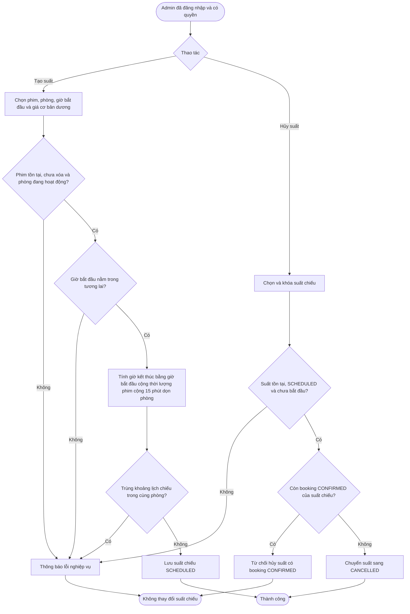

# Sơ đồ luồng nghiệp vụ hệ thống quản lý rạp phim

Tài liệu mô tả luồng nghiệp vụ theo mã nguồn hiện tại, đối chiếu ngày 29/10/2026. Luồng xem và hủy booking được cập nhật ngày 24/11/2026 theo Bước 0 của Pha 2 (hủy mềm, mốc 30 phút, quyền Admin). Sơ đồ dùng Mermaid; mở file bằng trình xem Markdown hỗ trợ Mermaid để hiển thị.

## 1. Phạm vi và tác nhân

| Tác nhân | Hoạt động |
|---|---|
| Khách vãng lai (Guest) | Xem phim, lịch chiếu, trạng thái ghế; đăng ký và đăng nhập |
| Khách hàng (Customer) | Đặt ghế, xem danh sách/chi tiết và hủy booking của mình sau khi đăng nhập |
| Quản trị viên (Admin) | Quản lý phim, phòng và sơ đồ ghế; tạo và hủy suất chiếu; xem và hủy mọi booking |
| Hệ thống | Xác thực, kiểm tra điều kiện nghiệp vụ, tính giá, lưu booking và bảo vệ ghế khỏi đặt trùng |

Hệ thống phục vụ một địa điểm rạp có nhiều phòng chiếu. Booking là một lần đặt từ 1 đến 8 ghế trong cùng một suất chiếu. Các hoạt động dưới đây được thực hiện qua API; dự án chưa có giao diện khách hàng riêng.

## 2. Sơ đồ nghiệp vụ tổng thể

Các đường quay lại chọn ghế biểu diễn cách khách có thể thao tác tiếp sau lỗi; API không tự động chọn hoặc thử đặt ghế thay khách.

## 3. Luồng đăng ký và đăng nhập

Đăng ký công khai luôn tạo tài khoản `CUSTOMER`. Các API quản trị yêu cầu vai trò `ADMIN`. Khi xử lý booking, hệ thống lấy mã người dùng từ JWT đã xác thực.

## 4. Luồng đặt ghế chi tiết

| Quy tắc | Nội dung |
|---|---|
| Số lượng | Mỗi booking có 1–8 ghế; không chấp nhận mã ghế trùng hoặc rỗng |
| Suất chiếu | Phải tồn tại, có trạng thái `SCHEDULED` và thời điểm bắt đầu nằm trong tương lai |
| Ghế | Phải thuộc phòng của suất chiếu và chưa được đặt trong chính suất đó |
| Giá STANDARD | Bằng giá cơ bản của suất chiếu |
| Giá VIP | Bằng giá cơ bản nhân `1.20` |
| Tổng tiền | Tổng giá đã chốt của từng ghế; giá ghế và tổng tiền làm tròn 2 chữ số thập phân, `HALF_UP` |
| Nguồn giá | Hệ thống tự tính từ dữ liệu suất chiếu và loại ghế, không nhận giá do khách tự khai |
| Chống đặt trùng | Khóa suất chiếu trong giao dịch; partial unique index cho cặp suất chiếu và ghế, chỉ tính ghế chưa giải phóng (`released_at IS NULL`), nên ghế của booking đã hủy được đặt lại |
| Tính toàn vẹn | Booking và các ghế được lưu cùng giao dịch; lưu thất bại thì hoàn tác toàn bộ |

**Lưu ý về thanh toán:** booking hiện được ghi nhận ngay khi lưu thành công và giữ ghế. Trường `paymentStatus` khởi tạo là `PENDING`, nhưng chưa có luồng thanh toán thật hay tự động hết hạn. Đây là trạng thái thanh toán, không phải trạng thái giữ ghế tạm.

## 5. Luồng xem và hủy booking

### 5.1. Xem booking

### 5.2. Hủy booking (hủy mềm)

### 5.3. Vòng đời booking

| Quy tắc | Nội dung |
|---|---|
| Hủy mềm | Không xóa bản ghi. Booking chuyển sang `CANCELLED` kèm `cancelled_at`; ghế được giải phóng bằng `released_at`, trong cùng giao dịch |
| Mốc 30 phút | So với giờ bắt đầu suất chiếu. Còn đúng 30 phút vẫn hủy được |
| Hủy lại | Booking đã `CANCELLED` trả `409 BOOKING_CANNOT_BE_CANCELLED` |
| Quyền hủy | Customer chỉ hủy booking của mình; booking của người khác trả `404`. Admin hủy được mọi booking nhưng vẫn theo trạng thái và mốc 30 phút |
| Hủy đồng thời | Hàng booking bị khóa trong giao dịch, nên chỉ một yêu cầu hủy thành công; yêu cầu sau nhận `409` |
| Đặt lại ghế | Ghế có `released_at` được coi là trống; lịch sử booking cũ vẫn còn |
| Thanh toán | Hủy booking không đổi `paymentStatus`; chưa có hoàn tiền |

## 6. Luồng tạo và hủy suất chiếu của Admin

- Admin cần chuẩn bị phim, phòng và sơ đồ ghế trước khi tạo suất; phim và phòng có thể được tạo theo thứ tự bất kỳ.
- Phim được xóa mềm. Phòng cũng được xóa mềm và không được xóa khi còn suất `SCHEDULED` trong tương lai.
- Tạo booking và hủy suất dùng chung cơ chế khóa suất chiếu để tránh đồng thời đặt thành công vào một suất vừa bị hủy.
- Guard hủy suất chỉ xét booking `CONFIRMED`, kể cả khi `paymentStatus = PENDING`. Booking đã `CANCELLED` không chặn việc hủy suất.

## 7. Phân biệt hiện trạng và yêu cầu dự kiến

Bảng dưới ghi hiện trạng trong mã nguồn của các nội dung nêu ở tài liệu đặc tả/yêu cầu; một số nội dung vẫn là định hướng, chưa triển khai:

| Nội dung | Hiện trạng dùng trong sơ đồ |
|---|---|
| Danh tính và quyền sở hữu booking | Đã lấy người dùng từ JWT; Customer xem/hủy theo cả `bookingId` và mã người dùng; Admin theo `bookingId` |
| Hủy booking | Đã hủy mềm, giải phóng ghế bằng `released_at`; chỉ hủy khi còn ít nhất 30 phút trước giờ chiếu |
| Trạng thái booking | Đã có `CONFIRMED`/`CANCELLED` và `cancelled_at` |
| Thanh toán | Có trường trạng thái thanh toán; chưa có quy trình thanh toán/hoàn tiền thật |
| Giữ ghế tạm và hết hạn | Chưa triển khai |
| Admin xem mọi booking | Đã có `GET /api/v1/admin/bookings` (phân trang); Admin xem chi tiết và hủy được mọi booking |

## 8. Nguồn đối chiếu

- [README dự án](../../README.md), [đặc tả hệ thống](SPEC.md) và [yêu cầu Booking](booking_requirements.md).
- [Xác thực và phân quyền](../../src/main/java/com/example/cinema/config/SecurityConfig.java).
- [Nghiệp vụ tài khoản](../../src/main/java/com/example/cinema/modules/identity/business/IdentityService.java).
- [API booking](../../src/main/java/com/example/cinema/modules/booking/api/BookingController.java), [API booking của Admin](../../src/main/java/com/example/cinema/modules/booking/api/AdminBookingController.java) và [nghiệp vụ booking](../../src/main/java/com/example/cinema/modules/booking/business/BookingService.java).
- [Lưu và hủy mềm booking, kiểm tra booking khi hủy suất](../../src/main/java/com/example/cinema/modules/booking/data/BookingRepositoryAdapter.java).
- [Migration hủy mềm booking](../../src/main/resources/db/migration/V9__soft_cancel_bookings.sql).
- [Nghiệp vụ suất chiếu](../../src/main/java/com/example/cinema/modules/theater/business/ShowtimeService.java) và [nghiệp vụ phòng chiếu](../../src/main/java/com/example/cinema/modules/theater/business/AuditoriumService.java).

Khi tài liệu cũ và mã nguồn khác nhau, tài liệu này ưu tiên hành vi trong mã nguồn để mô tả luồng hiện tại.
